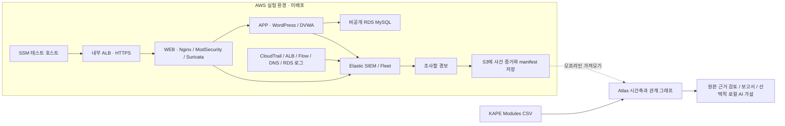

# Evidence Atlas 개발·검증 기록

> 프로젝트 소개와 주요 결과는 [README.md](README.md)에 정리합니다. 이 문서는 기존 환경 정보·진행 체크리스트·검증 범위를 보존하며, 이후 진행 상태도 이곳에서 관리합니다.

**수집한 포렌식 증거를 시간축과 관계 그래프로 탐색하는 DFIR 분석 도구이며, AWS 관제·증거 수집 실험 코드를 함께 관리하는 저장소입니다.**

KAPE Modules CSV와 검증된 사건 증거 묶음에서 출처·원래 값·해시를 보존하고, 연결 근거를 따라 조사할 수 있게 합니다. AWS 실험은 웹/DB·방어 정책부터 로그 수집, SIEM 경보, 증거 반출, Atlas 분석까지 검증하는 것이 목표입니다.

> **2026-09-16 상태:** 로컬 구현·회귀 및 일부 실제 Linux 서비스 검증 완료. **AWS 미배포**, 실제 계정·AMI·견적·Agent 등록·로그 전달 수락 검사는 남아 있습니다. Atlas의 AWS 연동은 **manifest 기반 오프라인 가져오기 초기 구현**입니다.

[로컬 실행](#로컬에서-시작하기) · [상세 사용법](docs/USAGE.md) · [AWS 구성](cloud-lab/README.md) · [배포 절차](cloud-lab/DEPLOYMENT.md) · [최신 검증 결과](cloud-lab/results/SCENARIO_FIXES.md) · [설계서](DESIGN.md)

## 현재 가능한 일과 남은 일

| 영역 | 구현·확인한 범위 | 남은 범위 |
|---|---|---|
| 증거 탐색 | KAPE CSV 수집, SQLite 원래 행·출처·해시, 시간순 맵, 1~2단계 관계 그래프, 근거 조회 | 소스별 의미 해석 확대, 다중 호스트 상관 후보 |
| 선택 분석 기능 | Neo4j 투영, ES 동기화·검색, Sigma 매칭 CLI/API, 로컬 Ollama 가설 연결 | ES 기반 뷰어, Sigma 표시 UI·정확도 평가, AI 실제 품질 평가 |
| 다중 소스 | Sysmon 1/3/11/22·SRUM 어댑터, MFT/USN 디스크 인덱스 저장 | **MFT/USN 검색 통합 오류**, 전용 소스 표시·통합 검증 |
| AWS 인프라 | 2계정·3계층 서비스의 OpenTofu 코드, 설치 스크립트, ModSecurity/Suricata·Elastic 설정 | 실제 AWS 배포, 권한·통신·Agent·로그·차단 수락 검사 |
| 관제·증거 수집 | SIEM 규칙 13개, 사건·수집 워크플로 코드, Linux triage, 해시/manifest, 증거 반출·가져오기 | 실제 경보→수집 검증, AWS IAM/STS 관계 모델, SIEM→Atlas 자동 전달 |
| 실험·대응 | S0~S3 제한 HTTP 준비 검사, S4~S6 수동 수락 절차, 추가 시나리오 36개 명세·준비 조건 | 36개 실험의 실행 환경·실증, 자동 격리/IAM 대응·복구 실행기 |

**151개 테스트 통과는 AWS 운영 검증이나 모든 기능 완성을 뜻하지 않습니다.** MFT/USN은 저장 상태 `complete`와 검색 조건 `indexed`의 불일치가 남아 있습니다. 과거 Sysmon 시간축 오류는 fallback을 추가해 보완했습니다.

## 전체 흐름

아래는 목표 파이프라인입니다. AWS 구간은 코드와 로컬 검증 단계이며, Atlas로의 증거 전달은 현재 반출 후 가져오기 방식입니다.



WEB/APP의 Elastic Agent·Defend는 별도 등록·동작 확인이 필요합니다. high/critical **EC2** 경보만 자동 사건 대상이며 자동 수집은 기본 비활성입니다. 그 외 경보는 검토 큐로 보냅니다. 관계 그래프의 선은 공유 참조이며 인과·악성 확정이 아닙니다.

## 로컬에서 시작하기

Python **3.11 이상**이 필요합니다. 아래 명령은 저장소 루트에서 실행하며 AWS를 배포하지 않습니다. 기본 수집·조회에는 Neo4j·Elasticsearch·Ollama가 필요하지 않습니다.

```powershell
git clone https://github.com/acvbbnm/dfir.git evidence-atlas
cd evidence-atlas
python -m venv .runtime/atlas-venv

# 실제 KAPE Modules CSV 폴더로 바꾸세요. 원시 EVTX/PF/하이브는 직접 파싱하지 않습니다.
.runtime/atlas-venv/Scripts/python.exe -m dfir_graph --db data/evidence.sqlite ingest D:\KAPE_RESULT --case CASE-001 --time-zone unknown
.runtime/atlas-venv/Scripts/python.exe -m dfir_graph --db data/evidence.sqlite stats
.runtime/atlas-venv/Scripts/python.exe -m dfir_graph --db data/evidence.sqlite serve --port 8765
```

실행 후 [http://127.0.0.1:8765](http://127.0.0.1:8765)를 엽니다. **DB를 먼저 가져와야** 조회 서버가 시작됩니다. `data/`, `.runtime/`, `vendor/`는 Git에서 제외되어 기존 개발 PC의 사건 DB·설치 파일·Sigma 규칙이 새 clone에 포함되지 않습니다.

`--time-zone unknown`은 시간대가 확인되지 않은 값을 임의로 UTC 변환하지 않습니다. 수집/파서의 시간대를 확인했다면 `UTC` 또는 `+09:00`을 지정하세요. 호스트가 여러 대면 입력 폴더를 나누고 `--host`를 지정합니다. `--db`는 항상 하위 명령 앞에 둡니다.

선택 기능은 `.runtime/atlas-venv/Scripts/python.exe -m pip install -r requirements.txt`로 의존성을 설치한 뒤 [상세 사용법](docs/USAGE.md)을 따릅니다. Neo4j/ES 서버, Sigma 규칙, Ollama 모델은 별도 준비 대상입니다.

### 반출한 클라우드 사건 열기

이 저장소의 검증 계약에 맞는 `manifest.json`과 증거 파일이 있는 로컬 사건 폴더가 필요합니다. 임의의 S3 폴더나 ZIP을 그대로 넣는 명령이 아닙니다.

```powershell
.runtime/atlas-venv/Scripts/python.exe -m dfir_graph --db data/cloud-case.sqlite cloud-import D:\Evidence\CASE-001
.runtime/atlas-venv/Scripts/python.exe -m dfir_graph --db data/cloud-case.sqlite serve --port 8766
```

파일 해시·출처를 검증하며 부분 수집은 명시적인 `--allow-partial`이 필요합니다. 객체/ZIP 멤버 64MiB, 사건·ZIP 확장 256MiB 한도가 있습니다. 실제 반출 순서는 [DEPLOYMENT.md](cloud-lab/DEPLOYMENT.md)를 따릅니다.

## 진행상황

이 절을 진행 상태의 단일 출처로 사용합니다. 체크된 항목은 명시된 범위만 완료한 것이며, **로컬 완료와 AWS 현장 검증을 구분**합니다.

### Atlas 개발

- [x] Phase 1: SQLite→Elasticsearch 동기화·ECS 투영·CLI 검색
- [ ] Phase 1 후속: ES 직접 수집·백엔드 선택·ES 기반 시간축/뷰어
- [x] Phase 2: 시간축↔관계 그래프 탐색·출처/원본 근거 확인
- [x] Phase 3: 지원 범위 내 Sigma 매칭·detections 저장·CLI/API
- [ ] Phase 3 후속: 시간축/그래프 후보 표시와 오탐·정탐 평가
- [ ] Phase 4: MFT/USN 검색 통합 및 다중 소스 검증 완료
- [ ] Phase 5: 다중 호스트·세션 상관 후보와 검증
- [ ] 로컬 AI: 실제 추론 품질·정답 사건셋 평가

### AWS 배포 전 완료한 준비

- [x] 인프라·보안 정책·로그/증거 파이프라인 설계와 OSS 재사용 검토
- [x] foundation/lab/automation IaC, 서버 설치·수집·SIEM 설정 코드
- [x] 버전·해시 고정, 배포 입력 생성, 제한된 HTTP 실행기와 원기록 계약
- [x] 36개 추가 시나리오의 전제·로그·탐지·대응 조건 검토와 보완
- [x] cloud-lab 72개 + Atlas 79개 = **151개 로컬 테스트 통과**
- [x] OpenTofu 3단계 fmt/init(backend 비활성)/validate 통과
- [x] 격리 Linux 서비스에서 WAF·웹/DB·SIEM·Velociraptor와 초기 Atlas 가져오기 검증

### AWS 전체 로드맵 — 현장 수락 포함

| 단계 | 상태 | 완료에 필요한 결과 |
|---|---|---|
| A0 준비 | 진행 중 | 코드·버전/해시 준비 완료. 실제 계정·프로필·배포 역할·AMI·리전 견적 확인 필요 |
| A1 기반 인프라 | 미배포 | 두 계정·VPC·SG·TLS·IAM·감사·SSM 실제 동작 |
| A2 서비스 | 미배포 | WordPress·DVWA·RDS 초기화 및 정상 요청·DB 권한 검증 |
| A3 관제 | 로컬 부분 검증 | AWS 로그 원본↔SIEM 대조, Agent 등록·이벤트, WAF/IPS/경보 검증 |
| A4 증거 수집 | 로컬 부분 검증 | AWS 경보→사건→수집→manifest/해시→반출 실증 |
| A5 Atlas 연동 | 초기 가져오기 | AWS/Linux/RDS 자원·IAM/STS 세션 관계와 자동 전달 개발·검증 |
| A6 대응·복구 | runbook 설계 | 격리·권한 제한·복구 실행기와 실제 효과 검증 |
| A7 평가·종료 | 미완료 | AI 평가, 통합 데모·보고서, 증거 보존·AWS 자원 정리 |

A0~A7을 완료 처리하려면 해당 실측 근거가 필요합니다. S0~S6은 준비·수락 검사이고 [추가 시나리오 36개](cloud-lab/scenarios/SCENARIO_LIBRARY.md)는 별도 실험 명세입니다. 36개 자동 공격 스크립트가 구현된 상태가 아닙니다.

## 검증 기록

| 기록 | 확인한 내용 |
|---|---|
| [2026-09-16 최신 수정·검증](cloud-lab/results/SCENARIO_FIXES.md) | 151개 테스트, 실제 ES 검색·집계, Fleet URL 저장, 지속성 원본 ZIP |
| [정적·회귀 원자료](cloud-lab/results/scenario-fix-validation.json) | cloud-lab 72개 및 OpenTofu 검사 출력 |
| [실제 서비스 원자료](cloud-lab/results/scenario-service-validation.json) | 격리된 ES/Kibana·Velociraptor 검사 결과 |
| [2026-09-15 기준선](cloud-lab/results/LOCAL_VALIDATION.md) | 당시 142개 테스트, WAF/웹/DB·SIEM·ZIP→Atlas 검사와 한계 |
| [로컬 재현 절차](cloud-lab/LOCAL_DEVELOPMENT.md) | 의존성, 검사 명령, 서비스 리허설 전제 |

실제 AWS IAM/KMS·교차 계정 권한·로그 전달, Agent 커널 이벤트, Suricata 실제 drop은 AWS 수락 검사로 남아 있습니다. 단순 HTTP 응답이나 룰 매칭을 침해 성공·차단 성공·분석 정확도의 증명으로 취급하지 않습니다.

## 문서와 디렉터리

| 경로 | 역할 |
|---|---|
| [docs/USAGE.md](docs/USAGE.md) | 시간순 맵·관계 탐색, 가져오기·내보내기, Neo4j/ES/Sigma/AI, 과거 실데이터 검증 |
| [DESIGN.md](DESIGN.md), [AGENTS.md](AGENTS.md) | 핵심 원칙·확장 계약·개발 규칙 |
| [cloud-lab/README.md](cloud-lab/README.md) | AWS 구성과 문서 진입점 |
| [cloud-lab/DEPLOYMENT.md](cloud-lab/DEPLOYMENT.md) | 실제 구현에 맞춘 배포·수락·반출·종료 순서 |
| [cloud-lab/BUILD_AND_ATTACK.md](cloud-lab/BUILD_AND_ATTACK.md) | 서버/방어 정책·구축 작업·실험 기준 |
| [cloud-lab/CLOUD_FORENSICS.md](cloud-lab/CLOUD_FORENSICS.md) | IAM·감사·휘발성·증거 수집 설계 |
| [cloud-lab/OPEN_SOURCE.md](cloud-lab/OPEN_SOURCE.md) | AWS 샘플·OSS 활용 범위와 출처 |
| [dfir_graph/](dfir_graph/), [tests/](tests/) | Atlas 구현·회귀 검사 |
| [cloud-lab/siem/README.md](cloud-lab/siem/README.md) | Elastic 설정·로그 파서·13개 경보 규칙의 범위 |

## 운영 범위

- 원래 값과 해시·출처를 보존하고, `time_kind`와 사건·호스트·수집 범위를 구분합니다. CSV 해시는 원래 디스크 취득 무결성이나 전체 증거 보관 절차를 대신하지 않습니다.
- AI는 선택적 로컬 Ollama 가설 생성입니다. 근거 식별자를 검증하지만 판단 정확도를 보장하지 않으며 차단 도구를 제공하지 않습니다.
- 로컬 뷰어는 루프백에서 사용합니다. 다중 사용자 인증·사건별 접근 제어는 구현하지 않았습니다.
- AWS 실험은 소유한 격리 환경에서만 수행합니다. 기본 WAF는 ModSecurity/CRS이고 AWS WAF는 꺼져 있습니다.
- 총 AWS 예산 목표는 **$300**이며 확정 견적이 아닙니다. `idle`은 NAT/Endpoint 제거 모드로 **EC2·RDS를 중지하지 않습니다**. 중지·삭제·잔여 비용은 배포 문서에서 별도로 확인합니다.
