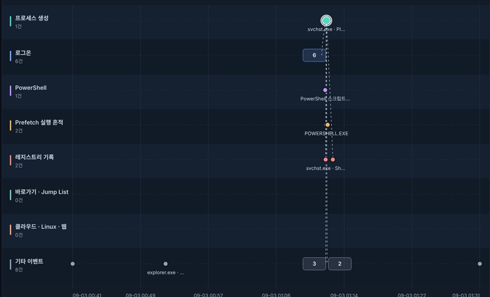

# Evidence Atlas

KAPE가 수집한 Windows 포렌식 기록을 시간축과 관계 그래프로 엮고, 조사 근거를 원래 CSV 행까지 추적하는 도구입니다.

[사용법](docs/USAGE.md) · [설계](DESIGN.md) · [로컬 검증](cloud-lab/results/SCENARIO_FIXES.md)

## Windows에서 실행

Python 3.11 이상과 KAPE Modules에서 내보낸 CSV 폴더가 필요합니다. 기본 뷰어는 Python과 SQLite로 실행합니다. 아래 예시의 `D:\KAPE_RESULT`를 실제 CSV 경로로 바꿉니다.

~~~powershell
git clone https://github.com/acvbbnm/dfir.git evidence-atlas
cd evidence-atlas
python -m venv .venv
.\.venv\Scripts\python.exe -m dfir_graph --db data/evidence.sqlite ingest D:\KAPE_RESULT --case CASE-001 --time-zone unknown
.\.venv\Scripts\python.exe -m dfir_graph --db data/evidence.sqlite stats
.\.venv\Scripts\python.exe -m dfir_graph --db data/evidence.sqlite serve --port 8765
~~~

브라우저에서 http://127.0.0.1:8765를 열고 실행 흔적을 선택합니다. 같은 파일이나 계정을 가리키는 연결을 따라간 뒤 원본 행과 출처를 확인할 수 있습니다. 출처의 시간대를 확인한 경우 해당 값을 지정하고, 확인 전에는 `unknown`으로 원래 시각을 보존합니다.

## 조사 근거를 남기는 방식

- 원래 행, 파일 해시, 수집 출처를 SQLite에 보존합니다. 기록 시각과 실행 시각은 다른 종류로 표시합니다.
- 그래프 연결에는 공유한 경로나 계정 등 연결 근거를 남깁니다. 인과관계는 조사자가 추가 기록으로 검토합니다.
- Sigma 매칭과 로컬 모델의 가설은 검토 후보입니다. 검색·그래프 연동과 선택 기능은 [상세 사용법](docs/USAGE.md)에 있습니다.

AWS 실험은 구성 코드와 로컬 리허설까지 진행했습니다. 반출한 증거 묶음의 manifest와 해시를 검사해 가져오는 방식이며, 실제 AWS 배포와 MFT·USN의 검색 통합은 [개발 기록](DEVELOPMENT.md)에 남아 있습니다.
