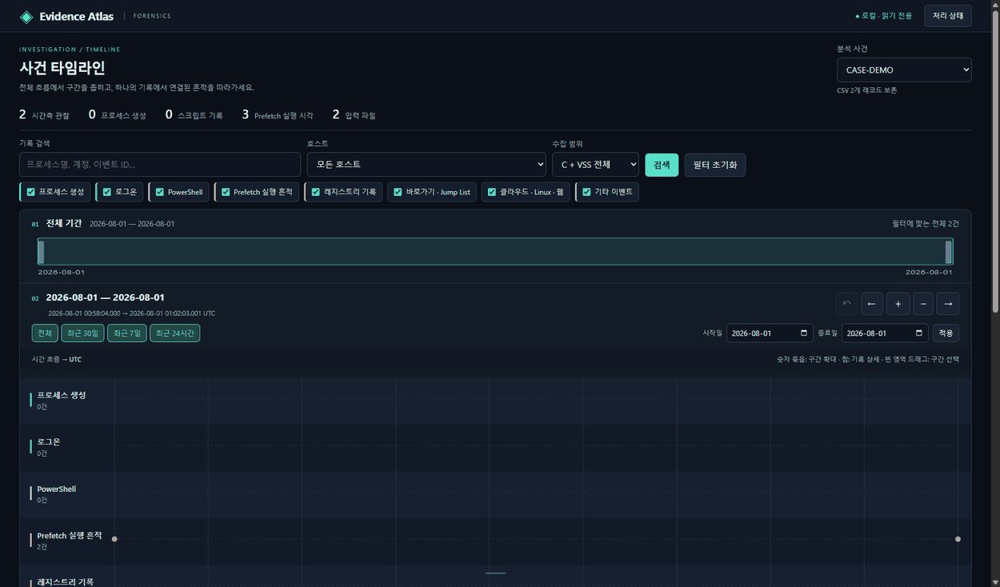

# Evidence Atlas

Windows 포렌식 기록을 시간축에서 따라가고, 실행 흔적 하나를 원본 CSV 행까지 확인하는 조사 도구입니다.

개인 프로젝트 · 2026년 9월 로컬 검증 · 수집·저장 모델과 조사 뷰어 설계·구현

[실데이터 검증 기록](docs/USAGE.md) · [설계 문서](DESIGN.md) · [로컬 검증 범위](cloud-lab/results/SCENARIO_FIXES.md)

합성 Prefetch 기록으로 실행 시각과 원본 근거를 확인하는 장면입니다.

## 타임라인과 관계를 만든 기준

~~~mermaid
flowchart LR
    A["KAPE Modules CSV"] --> B["아티팩트 파싱 · 파일 SHA-256"]
    B --> C["SQLite · 원본 행과 관찰 기록"]
    C --> D["시간축 · 기록 시각과 실행 시각"]
    C --> E["관계 그래프 · 공유 참조"]
    D --> F["원본 CSV 행과 연결 근거"]
    E --> F
~~~

Python으로 아티팩트 형식별 파서를 나누고, SQLite 한 파일에서 출처·원본 행·관찰 기록을 관리했습니다. 시간축과 Cytoscape.js 관계 그래프에서 같은 증거를 조회합니다. 연결에는 공유한 계정이나 경로를 남겨, 조사자가 인과관계를 판단할 때 근거를 다시 확인할 수 있게 했습니다.

## Sysmon 기록을 추가하며 발견한 시간축 누락

Sysmon 어댑터가 이벤트를 읽어 저장했지만 일부 새 이벤트 유형은 기존 시간축에서 표시되지 않았습니다. 가져오기 결과와 뷰어의 표시 조건을 따로 검사했고, 알려진 레인에 배치할 수 없는 유형은 기본 레인으로 보이도록 보완했습니다. 9월 16일 기록에서 Atlas 회귀 테스트 79개가 통과했습니다. MFT·USN 검색 통합과 AWS 배포 검증은 [개발 기록](DEVELOPMENT.md)에 남아 있습니다.

[Windows에서 실행](docs/USAGE.md)
