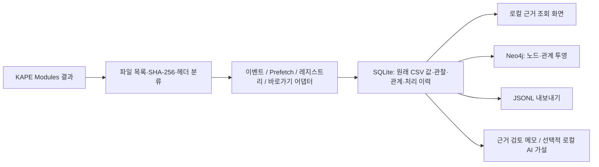

# Evidence Atlas · KAPE

KAPE **Modules CSV 결과**를 읽어 원래 레코드와 출처를 SQLite에 보관하고, 해석 가능한 관계를 Neo4j로 적재하는 로컬 프로토타입입니다. 웹 화면에서 대상을 검색하고 주변 관계를 펼친 뒤 근거 CSV 레코드를 확인할 수 있습니다.

기존 SIEM·ESXi와 독립적으로 실행합니다. 수집 에이전트, 유료 API, 클라우드가 필요하지 않습니다. 근거 검토 메모와 보고서, 선택적 로컬 Ollama 가설 생성을 지원합니다. AI 판정·차단·ATT&CK 자동 매핑은 구현하지 않았습니다. 현재 PC에는 Ollama/모델이 설치되지 않아 **AI 실제 추론은 아직 검증하지 않았습니다.**

## 시간순 전체 맵 사용법

1. 위쪽 **전체 기간 분포**는 현재 필터에 해당하는 모든 시각을 집계합니다. 드래그로 구간을 선택하거나 `최근 7일` 등으로 이동합니다.
   처음에는 전체 기간 분포와 마지막 기록 기준 최근 30일의 맵을 함께 보여줍니다. 오래된 Prefetch 한 건 때문에 주요 활동이 한쪽에 압축되는 것을 피하면서, `전체` 버튼으로 전체 기간 맵도 볼 수 있습니다.
2. 프로세스 생성·로그온·PowerShell·Prefetch·레지스트리·바로가기/Jump List·기타 Windows 이벤트를 서로 다른 행에서 시간순으로 봅니다. 숫자 묶음을 누르면 해당 시각 구간으로 확대되고, 충분히 확대하면 개별 점이 나타납니다.
3. 점이나 아래 목록의 행을 선택하면 기록 요약·연결된 흔적·원본 근거 패널이 열립니다. 원래 시각의 정밀도, 해당 Prefetch 시간 열, CSV 레코드와 해시를 확인할 수 있습니다.
4. `연결된 흔적`에서 같은 실행 참조·경로·계정 등을 공유하는 다른 관찰로 이동합니다. `연결된 기록의 시간대로 이동`으로 관련 기록의 범위를 펼칠 수 있습니다. 점선은 공유 참조를 나타내며 인과 주장이 아닙니다.
5. 아래 기록 목록은 50건씩, 연결된 흔적은 30건씩 페이지를 이동해 끝까지 탐색합니다. 확대 전에도 전체 집계에서 기록을 샘플링하거나 임의로 버리지 않습니다.

6. **분석 보조** 탭은 선택한 기록, 공유 참조 최대 20건, 같은 호스트·수집 범위의 ±5분 기록 최대 10건을 근거 묶음으로 제공합니다. 공유 경로·항목을 넓은 계정 연결보다 우선하고, 같은 우선순위에서 가까운 시각을 선택합니다. 전체 관련 건수와 포함 범위를 명시합니다. 시간 근접 자료는 관계 미확인으로 표시합니다. 검토 메모 `.md`와 근거 묶음 `.json`을 저장할 수 있습니다.

이 수집본의 시간축은 **171,360개 관찰**, 보존한 CSV는 **168,537개 레코드**입니다. Prefetch와 바로가기 한 행에서 여러 시각을 투영하므로 관찰 수는 CSV 행 수와 다릅니다. 시각 없는 관찰 904개는 그래프/원래 레코드에 보존하지만 시간축에서 제외합니다. EvtxECmd의 기타 이벤트 152,774개도 시간축에는 표시하지만 의미 관계를 새로 만들지는 않습니다. 화면 시각은 UTC이며 원래 값과 각 시각의 의미를 상세에 보존합니다. 파일 메타데이터에 2011년 시각도 포함되므로 시작 화면은 마지막 기록 기준 최근 30일을 보여줍니다.



## 현재 PC에서 열기

- 근거 조회: **http://127.0.0.1:8765**
- Neo4j Browser: **http://127.0.0.1:17474**
- Bolt: `bolt://127.0.0.1:17687`
- 데이터: `data/sba.sqlite`, 사건 ID `SBA-20260831`
- Neo4j 계정은 `neo4j`, 무작위 비밀번호는 `.runtime/connection.json`에 있습니다. 이 파일과 데이터 디렉터리는 Git에서 제외됩니다.

조회 화면은 SQLite의 그래프 투영을 직접 읽습니다. 따라서 Neo4j를 켜지 않아도 근거 조회가 가능합니다. Neo4j는 같은 그래프를 Cypher로 확장 탐색하는 용도입니다.

다음 실행 때 PowerShell에서:

```powershell
cd C:\Users\SBA_USER\Desktop\siem-project\dfir-graph
.\run.ps1
# Neo4j도 시작하려면:
.\run.ps1 -WithNeo4j
```

`run.ps1`은 Codex 번들 Python이 있으면 사용하고, 없으면 PATH의 Python을 사용합니다. `-PythonPath`로 Python 3.11 이상을 지정할 수 있습니다. 8765 포트에 이미 조회 서버가 실행 중이면 현재 주소를 이용하세요. 직접 실행한 조회 서버는 해당 콘솔에서 Ctrl+C로 종료합니다. Neo4j는 별도 백그라운드 프로세스이며 조회 서버 종료와 함께 종료되지 않습니다.

## 가져오기·내보내기

아래 `python`은 Python 3.11 이상입니다. 모든 명령은 이 디렉터리에서 실행합니다. `--db`는 하위 명령 **앞**에 둡니다.

```powershell
python -m dfir_graph --db data/sba.sqlite ingest D:\KAPE_RESULT --case SBA-20260831 --time-zone UTC
python -m dfir_graph --db data/sba.sqlite stats
python -m dfir_graph --db data/sba.sqlite search powershell --label ExecutableReference
python -m dfir_graph --db data/sba.sqlite evidence 'record:여기에_식별자'
python -m dfir_graph --db data/sba.sqlite export data/export
```

다른 수집본은 새 사건 ID를 사용하세요. `Computer` 값이 한 종류인 EvtxECmd 출력에서 Prefetch의 호스트를 추정하고 그 방식을 출처 메타데이터에 기록합니다. 여러 호스트가 섞여 있다면 호스트별로 입력 폴더를 나눠 `--host`를 지정하세요. 확인되지 않은 호스트는 미확정 상태로 남습니다.

시각에 시간대 표기가 없으면 `--time-zone` 가정으로 정규화합니다. 이 수집본은 **UTC 가정**으로 적재했으며 수집자의 설정을 독립적으로 검증한 것은 아닙니다. `LastModifiedTimeUTC`는 열 정의에 따라 UTC로 처리합니다. 모르면 `unknown`을 사용해 그 외 시각의 UTC 변환을 보류할 수 있습니다. 같은 사건·입력의 호스트/시간대나 이미 파싱된 어댑터의 해석 버전이 달라지면 새 사건/DB가 필요합니다. 새로 지원하는 어댑터는 이전 미지원 파일만 추가 처리하며 기존 레코드 식별자는 유지합니다.

## 로컬 분석 보조와 AI 연결

기본 근거 검토와 보고서는 모델 없이 작동합니다. 로컬 Ollama에 모델을 별도로 설치한 뒤 `run.ps1 -AIModel '설치된-모델명'` 또는 다음 CLI로 가설을 생성할 수 있습니다. 이미 실행 중인 서버에는 실행 옵션이 자동 반영되지 않습니다.

```powershell
python -m dfir_graph --db data/sba.sqlite analyze 'Observation:식별자' --markdown
python -m dfir_graph --db data/sba.sqlite analyze 'Observation:식별자' --model '설치된-모델명'
```

접속 대상은 `127.0.0.1:11434`로 고정합니다. 프록시·리디렉션·클라우드 모델을 허용하지 않으며 모델을 자동 설치하지 않습니다. 웹에서 버튼을 누를 때만 선택한 근거 묶음을 로컬 모델에 전달하고, 동시 추론은 1개로 제한합니다. 시간 제한은 120초입니다. 데이터 안의 지시문은 명령이 아니라 증거 문자열로 취급합니다. 모델에 셸, Cypher 실행, 차단 도구를 제공하지 않습니다.

가설은 제공한 근거 식별자만 인용하도록 검증합니다. **식별자의 존재를 검증하는 것이 주장의 정확성을 보증하지는 않습니다.** 모든 AI 결과는 미검토 가설이며 분석자가 확인해야 합니다. 응답 형식·없는 근거 인용·클라우드 차단은 모의 응답으로 검증했으나, 실제 모델의 정확도·한국어 품질·성능 평가는 남아 있습니다.

## Neo4j 설치와 적재

```powershell
# Windows x64: 공식 배포처에서 JRE 21 / Neo4j Community 5.26.30 다운로드
# 해시 검증 후 .runtime에만 설치. Windows 서비스/전역 PATH 변경 없음.
python scripts/setup_runtime.py --start
python -m dfir_graph --db data/sba.sqlite load-neo4j --local-config .runtime/connection.json
python scripts/verify_live.py --db data/sba.sqlite --reload
```

처음 설치할 때 인터넷이 필요합니다. 자료나 로그를 외부로 전송하는 기능은 없습니다. 이미 Neo4j가 있다면 `python -m pip install -r requirements.txt` 후 `NEO4J_PASSWORD` 환경변수와 `--uri`, `--user`, `--database`를 사용하세요. 로그인 비밀값을 소스 코드에 넣지 않습니다.

설정은 루프백 접속, 인증 활성화, JVM 최대 힙 512MiB, 페이지 캐시 256MiB입니다. 전체 프로세스 메모리는 이 합보다 클 수 있습니다. 저장 공간은 SQLite, Neo4j 데이터·트랜잭션 로그, 선택적 JSONL 내보내기에 추가로 필요합니다. 설치 압축파일도 `.runtime`에 남습니다.

Cypher 예시는 [queries/investigate.cypher](queries/investigate.cypher)를 참조하세요. `MERGE`는 노드·관계의 안정적인 식별자로 재적재하며 기존 그래프를 삭제하지 않습니다. 적재 도중 중단돼도 같은 명령을 다시 실행할 수 있습니다. SQLite는 근거의 기준 저장소이고 Neo4j는 재생성 가능한 투영입니다. 두 DB를 동시에 확정하는 분산 트랜잭션은 없습니다.

## 지원 범위

| 입력 | 원래 레코드 보존 | 그래프 처리 |
|---|---|---|
| EvtxECmd CSV | 모든 행 | Security 4624·4625·4688, PowerShell Operational 4104 |
| PECmd 기본 CSV | 모든 행 | LastRun 및 PreviousRun0–6, 실행 참조, 수집 범위 |
| Amcache 파일 항목 CSV | 모든 행 | 키 기록 시각, 항목별 메타데이터, 보고된 파일 경로 |
| AppCompatCache CSV | 모든 행 | 캐시가 보관한 파일 수정 시각, 경로 |
| RECmd BAM / UserAssist 상세 CSV | 모든 행 | 실행 시각 필드, 경로/프로그램 참조, BAM 계정 |
| LECmd CSV | 모든 행 | 바로가기 생성·수정 및 저장된 대상 시각, 대상 참조 |
| JLECmd Automatic / Custom CSV | 모든 행 | DestList/컨테이너 및 저장된 대상 시각, 대상 참조 |
| PECmd Timeline CSV | 파일 목록·해시만 | 기본 출력의 파생 결과이므로 중복 적재 제외 |
| TXT 콘솔 로그 | 파일 목록·해시, 일부 오류 상태 | 도구 처리 상태로 기록 |
| MFT, USN, 기타 RECmd/Amcache 출력 등 | 파일 목록·해시만 | 미지원으로 표시, 내용 파싱하지 않음 |

폴더 이름이 아닌 CSV 헤더로 어댑터를 선택합니다. 원시 EVTX/PF/레지스트리 하이브는 직접 파싱하지 않습니다. EvtxECmd의 `Payload`는 이름이 붙은 EventData를 담은 JSON 형태를 지원합니다. 다른 출력 형식은 어댑터 확장이 필요합니다.

## 관계의 의미

- 프로세스 인스턴스는 개별 생성 레코드로 식별합니다. CSV의 이벤트 발생 주체 `ProcessId`, EventData의 생성 주체 `ProcessId`, 새 프로세스 `NewProcessId`를 구분합니다.
- 부모 PID는 `ProcessReference`로 남깁니다. PID 재사용과 생존 구간을 확인할 자료가 부족하므로 다른 실행과 자동 병합하지 않습니다.
- C와 VSS2는 별도 수집 범위입니다. 같은 실행 흔적이 두 범위에 있어도 두 관찰의 출처를 유지합니다. 관찰 개수는 고유 실행 횟수와 다릅니다.
- `FilePath`는 경로 참조이고 파일 내용의 동일성을 보장하지 않습니다. PECmd `Hash`는 Prefetch 식별에 쓰는 값이며 실행 파일 SHA-256이 아닙니다.
- 4104는 스크립트 블록 조각 기록입니다. 각 문장의 실행을 입증하거나 완전한 스크립트로 재조립하지 않습니다.
- Prefetch와 4688 사이에 이름·시각이 유사하다는 이유만으로 동일 프로세스 관계를 만들지 않습니다. 4688·Amcache·ShimCache·UserAssist·바로가기의 **같은 호스트·정규화 경로 참조**를 통해 자료 간 이동을 지원합니다. 같은 경로라도 다른 시점에 내용이 바뀔 수 있으며 수집 범위도 반드시 대조해야 합니다.
- BAM의 `\\Device\\HarddiskVolumeN`을 임의로 C:에 매핑하지 않습니다. 볼륨 대응이 없는 경로와 UserAssist의 GUID/셸 식별자는 미확정 참조로 남습니다. RECmd 상세 파일의 C/VSS 범위는 요약 CSV의 `PluginDetailFile → HivePath` 연결이 유일할 때만 확인하며 연결한 요약 파일·행 번호를 출처에 기록합니다.
- Amcache 항목은 각 원래 레코드별로 보존합니다. 보고된 SHA1은 독립적으로 검증한 전체 파일 해시가 아닙니다. Amcache 키 기록·ShimCache 파일 수정·바로가기에 저장된 대상 시각을 실행 시각으로 표시하지 않습니다.
- 의미 관계에는 `evidence_id`가 붙고, 파일 구조 관계에는 출처 ID가 붙습니다. 논리 레코드 번호는 헤더를 제외한 CSV 행 순번이며 여러 줄 필드가 있어도 하나로 셉니다.
- Prefetch 근거 화면의 CSV 대표 시각은 `LastRun`입니다. 특정 과거 관찰 시각은 노드를 열어 `slot`과 `time_raw`를 보고 해당 `PreviousRunN` 원래 값과 대조하세요. 원래 시각의 100ns 자릿수는 보존하고, UTC 정규화에서 마이크로초 이하 절삭 여부를 기록합니다.

기록된 관계는 공격 판정이나 인과 확정이 아닙니다. 선택적 로컬 AI는 조회된 근거를 인용한 가설만 제안합니다. 데이터 안의 명령문이나 스크립트는 실행하지 않습니다.

## 이 수집본의 검증 결과

2026-09-09, `D:\KAPE_RESULT` 기준:

| 항목 | 결과 |
|---|---:|
| 입력 파일 목록·SHA-256 | 225개 |
| 파싱한 CSV | 27개 |
| 보존한 CSV 레코드 | 168,537개 |
| 프로세스 생성 4688 | 120개 |
| 로그온 성공 / 실패 | 6,067 / 5개 |
| PowerShell 4104 | 96개 |
| Prefetch 원래 레코드 / 유효 실행 시각 관찰 | 835 / 3,160개 |
| Amcache / ShimCache 레코드 | 4,246 / 2,048개 |
| BAM / UserAssist 레코드 | 504 / 1,408개 |
| LECmd / JLECmd 레코드 | 186 / 248개 |
| 그래프 노드 / 관계 | 28,877 / 79,956개 |
| 시간축 관찰 / 시각 없는 관찰 | 171,360 / 904개 |
| 반복 가져오기 | 225개 변경 없음, 중복 추가 없음 |

PECmd 오류 63개, Amcache 식별자 없는 행 16개, UserAssist 내부 관리 항목 등은 원래 레코드를 보존하며 실행 주장을 만들지 않습니다. 4688 120개는 CommandLine이 비어 있습니다. 콘솔 오류 패턴 1,566개는 도구 상태이며 공격 건수가 아닙니다. **미지원 178개 파일은 아직 의미 분석되지 않았습니다.**

기존 DB를 `data/sba-before-artifacts-20260909.sqlite`에 백업하고 확장했습니다. 기존 159,897개 레코드의 식별자/원래 값과 225개 출처 해시가 유지됨을 대조했습니다. SQLite 무결성/FK, Neo4j의 전체 노드·관계 식별자와 연결 끝점, 반복 가져오기/재적재를 검증했습니다. 별도 `sba_v2.sqlite` 시험본과 8766/8767 서버는 변경하지 않았습니다. 현재 확인 대상은 **sba.sqlite / 8765**입니다.

## 테스트와 운영 한계

```powershell
python -m unittest discover -s tests -v
python scripts/verify_live.py --db data/sba.sqlite --reload
```

단위 테스트는 반복 적재, 파일 단위 실패/재시도, PID 의미, 공급자별 Event ID 충돌, VSS 분리, Prefetch 오류, 시간대/정밀도, 출처 보존, 사건 분리와 출력 경로를 검증합니다. 실데이터는 파일별 트랜잭션으로 처리하며 실패한 파일만 재시도합니다. 입력 내용이 바뀌면 새 해시의 자료 버전으로 추가됩니다. 기존 버전이나 다른 경로의 중복 수집본을 자동 삭제·병합하지 않습니다.

19개 테스트가 통과했습니다. 추가 테스트는 새 어댑터의 원래 행 보존, C/VSS 연결 근거, 임의 드라이브 변환 방지, 자료 간 경로 연결, 파일 시각 의미, 근거 묶음 사건 분리, AI 인용 검증과 보고서 이스케이프를 확인합니다. 브라우저에서 새 아티팩트 상세와 분석 보조 탭을 확인했습니다.

시간순 맵은 해당 기간 전체를 집계하고 개별 기록은 페이지로 제공합니다. 참조 상세 창은 관계 150건, 처리 상태 창은 200건까지 표시하므로 전체 질의에는 CLI/Cypher를 사용할 수 있습니다. 본문 전체 검색, 사건별 접근 제어, 다중 사용자 인증과 분석 주석 저장은 아직 없습니다. 본인 PC의 신뢰하는 계정에서 사용하는 도구입니다. 그래프 참조를 함께 쓰는 기록도 같은 사건으로 제한합니다.

## 남은 개발 범위

- MFT/USN의 디스크 기반 인덱스와 선택적 시간축 투영. 실제 MFT는 파일 하나에 약 190만 행이므로 전량 그래프 노드화 전에 저장 공간과 탐색 성능을 검증해야 합니다.
- 나머지 RECmd·Amcache 및 SRUM/SUM 출력 지원. 현재 없는/실패한 수집 결과는 파서를 추가해도 복원되지 않습니다.
- 명시적인 볼륨·프로필 매핑, 반복 파서 출력의 중복 후보 표시, 프로세스 생존 구간을 이용한 부모 후보 검토.
- 로컬 모델 설치 후 실제 추론과 정답 사건셋 평가. 근거 인용 검증과 분석 품질 평가는 별개입니다.
- 분석자 주석·가설 승인 이력, 근거가 있는 탐지 규칙/ATT&CK 매핑과 오탐 평가.

해시는 **받은 CSV/TXT의 무결성**을 추적합니다. 원래 디스크 이미지·EVTX·PF의 취득 무결성이나 법적 증거 보관 절차를 대신하지 않습니다. 소스 코드와 생성한 증거 데이터, 접속 정보는 디렉터리와 Git 제외 규칙으로 분리했습니다.

## 구현 참고

- [EvtxECmd](https://github.com/EricZimmerman/evtx), [PECmd](https://github.com/EricZimmerman/PECmd)
- [AmcacheParser](https://github.com/EricZimmerman/AmcacheParser), [RECmd](https://github.com/EricZimmerman/RECmd), [LECmd](https://github.com/EricZimmerman/LECmd), [JLECmd](https://github.com/EricZimmerman/JLECmd)
- [Ollama 구조화 출력](https://docs.ollama.com/capabilities/structured-outputs), [로컬 생성 API](https://docs.ollama.com/api/generate)
- [Microsoft 4688 필드 설명](https://learn.microsoft.com/en-us/previous-versions/windows/it-pro/windows-10/security/threat-protection/auditing/event-4688)
- [Neo4j MERGE](https://neo4j.com/docs/cypher-manual/current/clauses/merge/), [Python 드라이버 배치 적재](https://neo4j.com/docs/python-manual/current/performance/)
