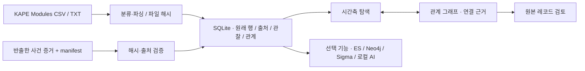

# Evidence Atlas

**흩어진 포렌식 흔적을 시간축과 관계 그래프로 연결하고, 분석의 근거를 원본까지 추적하는 DFIR 도구.**

KAPE가 수집·파싱한 Windows 아티팩트를 한곳에서 탐색하기 위해 만들었습니다. 같은 실행 파일·계정·경로를 가리키는 기록을 연결하되, **무엇을 관찰했는지와 무엇을 추정했는지를 구분하는 것**을 설계의 중심에 두었습니다.

[설계서](DESIGN.md) · [상세 사용법](docs/USAGE.md) · [검증 결과](cloud-lab/results/SCENARIO_FIXES.md) · [개발 기록](DEVELOPMENT.md)

## 1. 프로젝트의 출발점

포렌식 수집 결과에는 이벤트 로그, Prefetch, 레지스트리, 바로가기처럼 서로 다른 형식의 흔적이 섞여 있습니다. 파일별로 읽으면 같은 활동의 다른 단서를 놓치기 쉽고, 모든 시각을 동일한 실행 시각으로 해석하면 잘못된 결론에 도달할 수 있습니다.

| 질문 | 구현한 접근 |
|---|---|
| 여러 아티팩트에서 같은 대상을 어떻게 따라갈까? | 경로·계정·프로세스 등의 공유 참조를 그래프로 연결 |
| 이 시각이 실제로 무엇을 뜻할까? | 원래 시각 값과 `time_kind`를 함께 보존 |
| 화면의 요약을 믿어도 될까? | 원래 CSV 행·출처·SHA-256으로 돌아가는 근거 조회 |
| SIEM 경보 이후의 조사를 어떻게 이어갈까? | 사건 증거 묶음을 검증해 가져오는 오프라인 분석 경로 구현 |

## 2. 무엇을 만들었나

### 시간축과 관계 지도를 오가는 분석 화면

이벤트·실행 흔적·레지스트리·바로가기 기록을 시간순으로 보고, 선택한 기록에서 1~2단계 관계를 펼칩니다. 노드와 선을 선택하면 연결 근거와 원래 레코드를 확인하고 다시 시간축으로 돌아갈 수 있습니다.



### 근거를 보존하는 수집·분석 계층

| 산출물 | 내용 | 구현 위치 |
|---|---|---|
| CSV 수집 파이프라인 | 헤더 기반 분류, 파일 SHA-256, 원래 행 보존, 파일 단위 처리 이력 | [pipeline.py](dfir_graph/pipeline.py), [adapters.py](dfir_graph/adapters.py) |
| 증거 저장소·웹 뷰어 | SQLite 기준 저장소, 시간축↔관계 지도, 사건·수집 범위를 구분한 탐색 | [store.py](dfir_graph/store.py), [viewer.py](dfir_graph/viewer.py), [화면 코드](dfir_graph/static/) |
| 검색·그래프 연동 | Elasticsearch 동기화·ECS 투영·CLI 검색, Neo4j 투영 | [es_store.py](dfir_graph/es_store.py), [neo4j_io.py](dfir_graph/neo4j_io.py) |
| 탐지 후보·분석 보조 | 지원 범위의 Sigma 매칭·CLI/API, 근거 묶음·보고서와 선택적 Ollama 가설 | [sigma_engine.py](dfir_graph/sigma_engine.py), [analysis.py](dfir_graph/analysis.py) |
| 클라우드 증거 가져오기 | manifest와 파일 해시를 검증하고 출처·시각 의미를 보존 | [cloud.py](dfir_graph/cloud.py) |
| AWS 확장 실험 코드 | 2계정 인프라 IaC, 서비스 설정, SIEM 규칙 13개, Linux 증거 수집·반출 절차 | [cloud-lab/](cloud-lab/) |

핵심 기술은 **Python 3.11+ · SQLite · Vanilla JS · Cytoscape.js**입니다. 기본 수집·뷰어는 Neo4j·Elasticsearch·Ollama 없이 동작하며, 외부 서비스는 선택 기능입니다.

## 3. 설계에서 중요하게 다룬 것

**원본과 해석을 분리했습니다.** CSV 행은 `raw_json`으로 보존하고, 분석용 노드·관계는 별도 투영으로 만듭니다. 화면의 요약이 바뀌어도 입력 근거를 다시 확인할 수 있게 했습니다.

**시간의 의미를 지웠다가 다시 추정하지 않도록 했습니다.** 이벤트 기록 시각, Prefetch 실행 시각, Amcache 키 기록 시각 등 13종의 `time_kind`를 구분합니다. Amcache 기록을 곧바로 실행 증거로 단정하는 식의 해석을 피하기 위한 선택입니다.

**관계의 선에는 이유를 붙였습니다.** 같은 경로나 계정이 등장했다는 사실은 인과관계나 악성의 확정이 아닙니다. 각 연결에 `basis`를 남기고, C 드라이브와 VSS 수집본을 독립 보존하며 사건 간 참조를 분리합니다.

**AI도 근거 검토의 보조로 배치했습니다.** 로컬 Ollama의 출력은 미검토 가설로 취급합니다. 인용 식별자의 존재를 확인하는 것과 가설의 정확도를 보장하는 것은 구분합니다.

## 4. 결과와 검증

| 검증 기록 | 확인한 결과 | 해석 범위 |
|---|---|---|
| [실데이터 수집·탐색](docs/USAGE.md) · 2026-09-09 | CSV **168,537개 레코드**, 시간축 **171,360개 관찰** | 당시 개발 데이터 기준. 한 행에서 여러 시각을 투영할 수 있으며, 수집본·DB는 저장소에 포함하지 않음 |
| [Sigma 검증](DESIGN.md) · 설계서 5.3절 | 공격 샘플 134개 레코드에서 **125개 탐지 후보·39개 고유 규칙** | 후보 매칭 결과이며 정탐률·정확도 지표는 아님 |
| [로컬 회귀·서비스 검증](cloud-lab/results/SCENARIO_FIXES.md) · 2026-09-16 | Atlas 79개 + cloud-lab 72개 = **151개 테스트 통과 기록** | 기존 검증 기록. 실제 ES/Kibana·Velociraptor의 일부 서비스 검사 포함, AWS 현장 검증은 별도 |

**완성한 중심 결과물은 로컬 포렌식 탐색 도구와 검증 기록입니다.** AWS 확장은 인프라·수집·탐지 코드와 로컬 리허설까지 진행했으며 실제 AWS에는 배포하지 않았습니다. Atlas 연동은 manifest 기반 오프라인 가져오기입니다. MFT/USN 검색 통합, ES 기반 뷰어, 다중 호스트 상관 분석과 AI 품질 평가는 후속 범위이며 [개발 기록](DEVELOPMENT.md)에 상세 상태를 남겼습니다.

## 5. 만들면서 배운 점

| 경험 | 배운 점 |
|---|---|
| CSV 한 행에서 여러 시각이 나오고, 일부 기록에는 시각이 없음 | 레코드 수와 관찰 수는 다르다. 시각 없는 증거를 버리지 않고 시간축 표시와 원본 보존을 분리해야 한다 |
| 경로·계정이 여러 흔적에 반복 등장 | 그래프는 조사 후보를 찾는 데 유용하지만, 연결 자체를 공격의 증명으로 취급하면 안 된다 |
| SQLite 데이터를 ES·Neo4j로 확장 | 기준 저장소와 재생성 가능한 투영을 나누면 검색·시각화 기능을 확장하면서 원본을 유지할 수 있다 |
| MFT/USN 저장 상태와 검색 조건의 불일치 | 저장 성공만으로 사용 흐름의 완성을 판단할 수 없다. 수집→검색→근거 확인까지 통합 검증해야 한다 |
| 로컬 검사와 클라우드 배포 준비를 함께 수행 | 코드·테스트 통과, 서비스 동작, 실제 계정의 권한·로그 전달은 서로 다른 검증 단계다 |

## 6. 로컬에서 시작하기

Python **3.11 이상**과 실제 KAPE **Modules CSV** 폴더가 필요합니다. 원시 EVTX·PF·레지스트리 하이브를 직접 파싱하는 도구는 아닙니다.

```powershell
git clone https://github.com/acvbbnm/dfir.git evidence-atlas
cd evidence-atlas
python -m venv .runtime/atlas-venv

# D:\KAPE_RESULT를 실제 CSV 폴더로 변경
.runtime/atlas-venv/Scripts/python.exe -m dfir_graph --db data/evidence.sqlite ingest D:\KAPE_RESULT --case CASE-001 --time-zone unknown
.runtime/atlas-venv/Scripts/python.exe -m dfir_graph --db data/evidence.sqlite stats
.runtime/atlas-venv/Scripts/python.exe -m dfir_graph --db data/evidence.sqlite serve --port 8765
```

수집 후 [http://127.0.0.1:8765](http://127.0.0.1:8765)를 엽니다. `unknown`은 시간대 미확정 값을 임의로 UTC로 변환하지 않는 설정입니다. 확인된 수집 시간대가 있다면 `UTC`나 `+09:00`을 지정하세요. `data/`, `.runtime/`, `vendor/`는 Git에서 제외되며 선택 서비스·Sigma 규칙·AI 모델은 별도 준비합니다.

로컬 뷰어는 루프백에서 사용하는 분석 도구이며, 다중 사용자 인증·사건별 접근 제어는 제공하지 않습니다. 상세 명령과 선택 기능은 [사용법](docs/USAGE.md), 클라우드 증거 가져오기와 AWS 배포·비용·종료 절차는 [개발 기록](DEVELOPMENT.md)과 [배포 문서](cloud-lab/DEPLOYMENT.md)를 참고하세요.

## 7. 문서 안내

| 읽고 싶은 내용 | 문서 |
|---|---|
| 설계 원칙과 모델, 구현 선택 | [DESIGN.md](DESIGN.md) |
| 화면 조작·수집·검색·Sigma·AI 사용법 | [docs/USAGE.md](docs/USAGE.md) |
| 실데이터·로컬 서비스 검증 근거 | [사용법의 실데이터 기록](docs/USAGE.md), [최신 검증 기록](cloud-lab/results/SCENARIO_FIXES.md) |
| AWS 확장 설계와 수집 절차 | [cloud-lab/README.md](cloud-lab/README.md), [CLOUD_FORENSICS.md](cloud-lab/CLOUD_FORENSICS.md) |
| 개발 진행상황·남은 작업·운영 범위 | [DEVELOPMENT.md](DEVELOPMENT.md) |
| 활용한 오픈소스와 출처 | [cloud-lab/OPEN_SOURCE.md](cloud-lab/OPEN_SOURCE.md), [사용법의 출처](docs/USAGE.md) |
