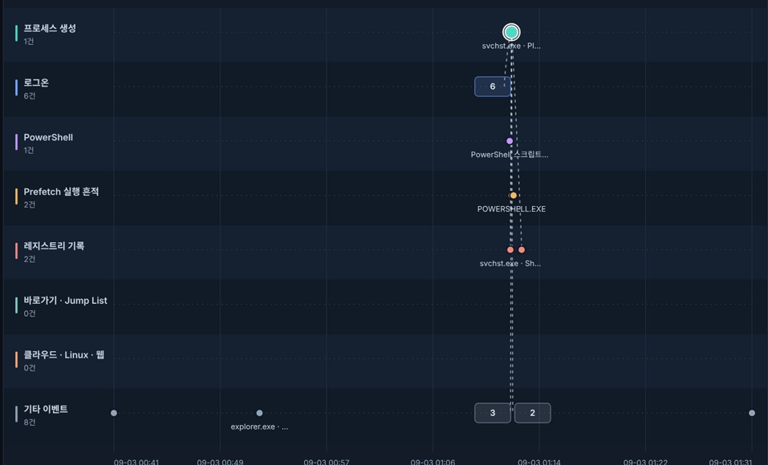

# 시간축과 관계 그래프

시간축에서 기록을 읽다가 같은 계정이나 경로가 등장한 다른 기록을 조사할 수 있게 했다. 두 화면에서 선택한 항목은 원본 CSV 행과 연결된다.

~~~mermaid
flowchart LR
    A["KAPE Modules CSV"] --> B["아티팩트 파싱 · 파일 SHA-256"]
    B --> C["SQLite · 원본 행과 관찰 기록"]
    C --> D["시간축 · 기록 시각과 실행 시각"]
    C --> E["관계 그래프 · 공유 참조"]
    D --> F["원본 CSV 행과 연결 근거"]
    E --> F
~~~

## 시각과 관계

Prefetch에 기록된 실행 시각과 Amcache 키가 기록된 시각을 `time_kind`로 구분한다. 조사 화면에는 시각이 무엇을 뜻하는지 표시한다.

그래프의 선에는 공유한 경로나 계정 등 연결 근거를 남긴다. 경로가 같은 두 기록은 조사자가 함께 볼 단서가 된다. 동일한 실행인지 판단할 때는 수집 범위와 원본 기록을 더 확인한다.

## 화면에서 확인

샘플 Prefetch 기록을 시간축에서 선택하면 실행 시각과 근거가 표시된다. 관계 그래프에서는 연결을 선택해 어떤 참조가 두 기록을 이어주는지 볼 수 있다.

[시간축 사용법](USAGE.md#시간순-전체-맵-사용법) · [관계의 의미](USAGE.md#관계의-의미) · [로컬 검증](validation.md)
